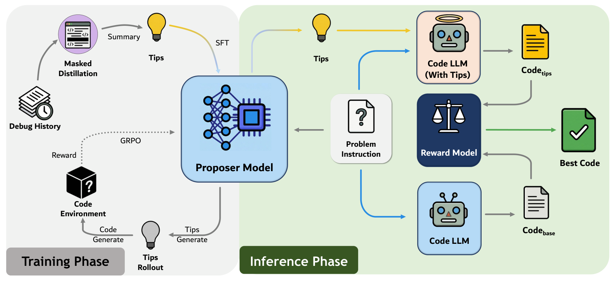

# TipCoder

### Reinforcement Learning Boosted Test-time Instruction Proposer for Code Generation

[](https://aclanthology.org/2026.findings-emnlp.495/)
[](LICENSE)

**Generate problem-specific tips. Explore an additional solution. Select with a reward model.**

TipCoder learns an instruction proposer from debugging trajectories, then refines
it with reinforcement learning. At inference time, a frozen code generator
produces a native solution and a tip-guided solution; a reward model selects
between them without access to test outcomes.

[Paper](https://aclanthology.org/2026.findings-emnlp.495/)
&nbsp; / &nbsp; [PDF](https://aclanthology.org/2026.findings-emnlp.495.pdf)
&nbsp; / &nbsp; [Quick Start](#quick-start)
&nbsp; / &nbsp; [Training](docs/TRAINING.md)
&nbsp; / &nbsp; [Evaluation](evaluation/README.md)

## Overview



*Figure 1 from the [paper](https://aclanthology.org/2026.findings-emnlp.495/):
training the instruction proposer (left) and selecting between native and
tip-guided solutions at inference time (right).*

The proposer explores **instructions**, rather than only sampling more programs
from the same prompt. Keeping the native candidate lets the selector retain a
solution when the additional guidance is unhelpful.

## Release Status

| Resource | Availability |
| --- | --- |
| Data construction, SFT/RL integration, inference, evaluation | Included in this repository |
| SFT and RL training datasets | Selected; Hugging Face upload pending |
| RL proposer weights | BF16 export prepared; Hugging Face upload pending |
| Remote BCB execution server and dependency image | External setup required |

See [artifacts](docs/ARTIFACTS.md) for dataset sizes and checkpoint packaging.

## Repository Guide

| Directory | Purpose |
| --- | --- |
| `data_construction/` | Hard-example filtering, repair trajectories, masked tip distillation, RL data formatting |
| `training/` | SFT/RL launchers and the modified OpenRLHF integration |
| `training/reward_server/` | Remote code rollout and execution-reward service for RL |
| `inference/` | Existing tip generation scripts and an optional code-generation adapter |
| `evaluation/` | Benchmark execution wrappers, RM scorers, optional reranking/bounds utilities |
| `docs/` | Setup, remote service boundaries, retained scripts and dependencies |

No datasets, model weights, experiment outputs, cluster launchers or credentials
are included. Supply model and dataset locations explicitly. GPU communication
uses the runtime defaults; launchers do not disable P2P, shared memory or IB,
bind a cluster network interface, or configure a tracking proxy.

## Quick Start

The tip generators retain their original processing behavior. The chat coder
adapter and generic reranking/bounds utilities below were added during cleanup;
they are optional examples, not replacements for the deployed experiment
pipeline. See [cleanup boundaries](docs/CLEANUP.md) before choosing an entry point.

### 1. Install the clients

Use Python 3.10 or newer. The evaluation module is independent of training.

```bash
git clone https://github.com/Minkow/TipCoder.git
cd TipCoder
python -m pip install -r requirements.txt
python -m pip install -e ./evaluation
```

### 2. Serve the proposer and coder

Install vLLM in a separate GPU environment
to serve the proposer and coder via OpenAI-compatible endpoints. Model versions
and GPU-library dependencies must be selected for your installed CUDA stack.

```bash
vllm serve /path/to/proposer --served-model-name proposer --port 8000
```

The proposer requires `/v1/completions` (preformatted training prompt), while
the portable coder client uses `/v1/chat/completions`. Serve the coder on a
separate port/GPU allocation; its endpoint must support `seed`.

```bash
# In another terminal, with a separate GPU allocation
vllm serve /path/to/coder --served-model-name coder --port 8001
```

### 3. Generate tips and candidate solutions

Export the original benchmark records to JSONL, preserving task IDs and fields.
For EvalPlus this can be done using `get_human_eval_plus` or `get_mbpp_plus`
from `evalplus.data`. Then:

```bash
python inference/generate_evalplus_tips.py --dataset humaneval \
  --cached-file data/humaneval.jsonl --api-base http://localhost:8000/v1 \
  --output outputs/humaneval_tips.jsonl

python inference/generate_code.py --input data/humaneval.jsonl \
  --api-base http://localhost:8001/v1 --model coder --output outputs/native.jsonl
python inference/generate_code.py --input outputs/humaneval_tips.jsonl \
  --api-base http://localhost:8001/v1 --model coder --output outputs/guided.jsonl
```

### 4. Select and evaluate

```bash
python -m pip install -r evaluation/requirements-rm.txt
python evaluation/rerank.py --prompts data/humaneval.jsonl \
  --candidates outputs/native.jsonl outputs/guided.jsonl \
  --rm-model /path/to/AceCodeRM --rm-kind ace --output outputs/selected.jsonl
bash evaluation/evalplus.sh humaneval outputs/selected.jsonl
```

> Execute generated code only in an isolated environment without credentials or
> sensitive mounts. Selection uses reward-model scores, never test outcomes.

<details>
<summary><strong>MBPP, BigCodeBench and context-window settings</strong></summary>

For MBPP use `--dataset mbpp`. For BCB generate the override records with
`inference/generate_bcb_tips.py`; use `--prompt-field instruct_prompt` for coder
generation and reranking. The BCB script resolves relative output paths under
`--local-cache-dir`; an absolute `--output` avoids ambiguity. Run
`evaluation/bigcodebench_remote.sh` to evaluate the selected code remotely.

For the BCB generator, configure `--tokenizer-models` (or `QWEN_CODER_MODEL`
and `DS_CODER_MODEL`) when using its original length guard. To match a run
that disabled this guard, pass `--max-prompt-tokens 0` explicitly; the script's
original default is 2048. No new tips sanitization or retry policy is added.

The new `generate_code.py` is a portable chat-API adapter, not the historical
EvalPlus/BCB fork's generation launcher. It extracts complete solutions using
EvalPlus sanitization. It does not silently truncate input prompts. Choose a
context window and output budget supported by your coder. Reranking consumes
already-cleaned code; it never uses execution outcomes to choose candidates.

</details>

## Training and Data

| Start here | What it covers |
| --- | --- |
| [Data construction](docs/DATA.md) | Hard-example filtering, debugging trajectories and tip distillation |
| [Training](docs/TRAINING.md) | SFT/RL launchers and the pinned OpenRLHF overlay |
| [Remote services](docs/REMOTE_SERVICES.md) | RL execution rewards and separate BCB evaluation |
| [Evaluation](evaluation/README.md) | Benchmark execution, AceCodeRM/InternLM scoring and candidate bounds |

Training targets **OpenRLHF commit `cf69bd61a5fbcfa4f07bad2af76797643ac557e5`**.
The installer applies our overlay to a fresh checkout. Use the pinned revision,
not the latest upstream release.

The organized release has CPU-level checks, but has not undergone a fresh
end-to-end GPU training run. Dependency compatibility depends on your environment.

## Citation

```bibtex
@inproceedings{chen-etal-2026-tipcoder,
  title = "{T}ip{C}oder: Reinforcement Learning Boosted Test-time Instruction Proposer for Code Generation",
  author = "Chen, Minyu and Wu, Sihao and Wu, Ling-I and Qin, Song and
            Li, Jingyang and Ning, Lei and Xue, Jianxin and Li, Guoqiang",
  booktitle = "Findings of the Association for Computational Linguistics: EMNLP 2026",
  year = "2026",
  publisher = "Association for Computational Linguistics",
  pages = "10363--10377",
  url = "https://aclanthology.org/2026.findings-emnlp.495/"
}
```

## License and Acknowledgments

Original contributions are released under [MIT](LICENSE), following AceCoder.
We build on AceCoder, OpenRLHF, EvalPlus and BigCodeBench. Third-party source
retains its own notices and licenses; see [NOTICE](NOTICE) and
[third-party attribution](THIRD_PARTY.md). Dataset and model releases carry
their own artifact documentation and terms.
